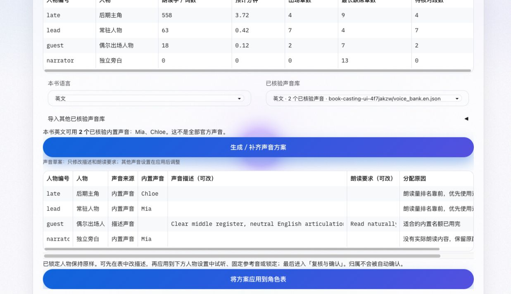

# 全书自动分配验收记录 · 2026-10-20

## 已通过

最终完整离线回归：747 项，717 通过、30 按环境条件跳过。运行方式：`OMP_NUM_THREADS=1 OPENBLAS_NUM_THREADS=1 PYTHONWARNINGS=ignore ./venv/bin/python -m unittest discover -s tests -t . -p '*test.py'`。使用 `-t .` 避免 tests 下同名包遮蔽源码。完整日志位于本机 `/tmp/book_casting_regression_final.log`。

新增测试覆盖全书覆盖证明、名单索引与段落分析分离、后期大量自述人物排名、分段不改变排名、缺席章数、未知归属隔断互动、不确认机器归属、性别适配、声音容量与匹配、锁定共享及库外锁定、描述批次失败续做和人工修改复用、停止与时限、旧方案与声音库失效、并发操作不覆盖项目。实际注册的 Gradio 事件经过 `Blocks.process_api` 检查 State、表格预处理、生成器反馈、应用和确认撤回。

## 浏览器检查

在独立本机端口 7998 使用临时英文 EPUB 和模拟 DeepSeek，实际页面完成：

- 查看 1/13 已分析章节；切换解析设置时识别不匹配结果。
- 显式补齐至 13/13，最终章节选择范围不被全书分析改写。
- 后期主角 558 词排在常驻人物 63 词之前，分别分配不同内置声音；偶尔出场人物使用描述声音；零内容旁白保留原配置但不占名额。
- 表中编辑描述，应用后从现有人物设置读回；发现当前人物不变时面板显示旧值，已补 `.then` 顺序刷新，并在最终版本确认当前人物直接显示新声音来源。
- 原来的「复核与确认」按钮可继续完成明确确认；没有点击正式合成或试听。
- 桌面与 390×844 窄屏检查，按钮在窄屏分行，表格保留自身横向滚动区域。窄屏 DOM 的可用宽度与页面 scrollWidth 均为 375px，未发生页面横向撑宽。没有宣称已经实测触屏拖动。

最终桌面草案图：

最终窄屏草案图：

重启隔离服务时，旧测试标签页短暂发送旧函数编号，出现旧事件输入不匹配；刷新后完成最终流程。用户更新服务后也需要刷新旧标签页。临时验收页与项目均不作为真实用户书籍结果。

一次界面静态检测只报告 `web_ui.py` 原有进度宽度动画 `transition: width`（非本次新增）；没有为此扩大改动范围。`git diff --check` 通过。

## 验证边界

本轮未运行真实 DeepSeek 请求、MiMo 试听或付费合成，未评价音色听感或真实辨识率。描述生成、声音库特征和确认入口已离线验收；最终声音质量仍需使用少量真实试听核验。正式项目仅在明确点击应用时写入，本次浏览器操作只修改隔离临时项目。

## 正式网页加载

原 7862 端口未运行服务，验收后已用现有虚拟环境启动正式 `main_ui.py`，监听 `127.0.0.1:7862`（启动时 PID 13224）。新浏览器会话可正常显示首页。旧标签页持续发送旧函数编号，正式日志出现输入数量不匹配，因此不能称为无错误启动；已提示刷新全部旧项目标签页。新全书控件只在载入剧本后的角色声音页展示，空书首页不挂载这些控件。隔离 7998 服务已关闭。未执行真实模型或音频请求。
