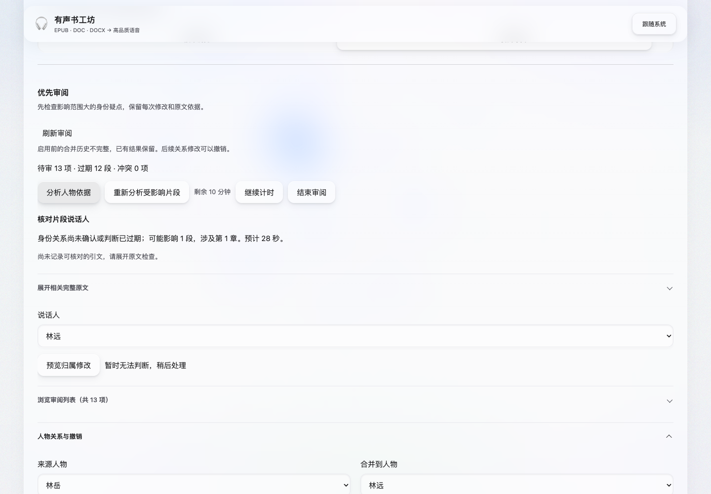
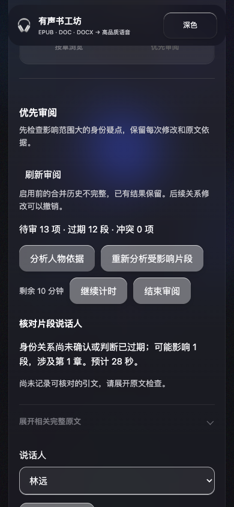

# 研究审阅自动化验收 · 2026-10-23

基于现有工作区实现，保留已有未提交改动。研究能力仅在 Vue 角色项目中显式启用。未调用真实收费分析/TTS 服务，也未下载或加载语音模型。

## 最终检查

| 检查 | 结果 |
| --- | --- |
| 后端完整 unittest | 885 项执行，855 通过、30 按环境跳过，无失败 |
| 研究领域/分析/服务专项 | 29 项通过；另有实际生成前的原文变更拒绝回归 |
| Vue / TypeScript | `vue-tsc --noEmit` 通过 |
| Vitest | 15 项通过 |
| Playwright 完整工作台 | 19 项通过 |
| 生产构建 | Vite 构建通过，更新 `frontend/dist` |
| OpenAPI / TypeScript 契约 | 导出并重新生成，类型检查通过 |
| 设计检测 | 研究审阅、差异及角色工作台组件检测无发现 |
| 补充检查 | Python 编译检查、`git diff --check` 通过 |

后端使用项目 `venv_audio_quality` 的 Python 3.11，完整检查在沙箱外执行以避开 OpenMP 共享内存限制。浏览器检查使用本机 Chrome 与临时 loopback 服务，全部数据位于临时目录。跳过项仍为既有环境限定测试，不代表已执行真实 GPU/语音合成。

## 闭环证据

`tests/services/research_workflow_test.py` 使用真实 HTTP 路由、Projects/ResearchService、TaskManager 和 spawn 子进程，替换的仅为模型响应和音频任务：

1. 建立研究快照并合并错误身份，预览不修改项目。
2. 人工撤销后，依赖的自动归属变为过期，源人物及独立人工决定保留。
3. 子进程只输出重新分析草稿；任务成功后由主进程校验修订并登记。
4. 查看/部分应用草稿，人工确认项及冲突项受保护；修改后旧草稿返回 409。
5. 再次确认剧本，模拟生成历史批次；比较当前计划，再返工变化章节到独立目录，旧目录仍在。

另覆盖单快照写入失败、删除索引后的恢复及备份去重、V2 加载、同词不同范围、传递依赖去重/循环、上下文检查、范围投影、传递身份矛盾、种子抽查、暂停恢复、预算结束、无 TTS 凭据的分析、停止后迟到结果、重启及旧版本拒绝。音频边界测试检查解释变化、停顿、服务端口、参考内容摘要、不连续章节和失败基线的未完成范围；实际写入产物前再次校验研究原文。

浏览器验收覆盖启用、优先/按章入口、合并预览、撤销、计时暂停、跳过、409 后保留选择、键盘触发预览，以及分析任务终态后自动显示草稿。草稿显示部分使用明确的 HTTP 契约替身；真实 spawn 草稿提交和模拟章节返工由服务测试承担。现有六引擎目录、普通角色编辑确认、资源库、日志、设置和页面导航的回归同轮通过。

## 模拟实验

两种适配器分别完成 **6 案例 × 4 组 × 3 预算 = 72 次**运行，均使用种子 `research-v1`、抽查间隔 10、预算 300/600/1200 秒。来源变更案例按设计拒绝分析。录制模式缺响应会失败，确定性假分析器不读取录制文件；模拟审阅者和评估器独立读取金标准。两种适配器本轮得到相同汇总指标，完整运行器另有重复运行一致性测试。

结果文件：

- [录制回放 CSV](recorded-results.csv)、[JSON 摘要](recorded-summary.json)、[完整回放及事件轨迹](recorded-replay.json)
- [假分析器 CSV](deterministic-results.csv)、[JSON 摘要](deterministic-summary.json)

以上均为作者编写的中文故事和模拟耗时，只证明流程、记录及运行器可以复现，不构成真实模型或真人审阅收益证明。C 与 D 在这些夹具上可能得到相同结果，不能据此宣布联合排序更优。完整命令、输入/金标准格式、策略参数及已知限制见[研究审阅说明](../../research_review.md)。

## 视觉检查

沿用当前主题、布局和组件。检查 1440px 浅色桌面和 390px 深色窄屏；窄屏无页面横向溢出。保留证据展开、原生选择框、焦点和键盘操作，未增加全局导航层。

正式真人研究、真实长小说标注、真实模型质量对比、GPU 合成听感和新旧整书自动拼装仍属于后续工作。
